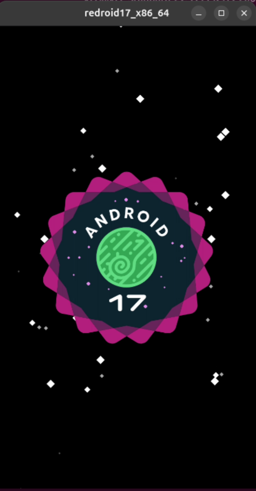

[English](README.md) | 简体中文

# 目录
- [概览](#概览)
- [开始](#开始)
- [配置](#配置)
- [原生桥接支持](#原生桥接支持)
- [GMS 支持](#gms-支持)
- [WebRTC 流](#webrtc-流)
- [如何构建](#如何构建)
- [解决故障](#解决故障)
- [联系我](#联系我)
- [许可](#许可)

## 概览
*redroid* (*远*程 安*卓*) 是一个GPU加速的 AIC (Android In Cloud) 解决方案. 你可以在Linux主机上启动许多
实例 (`Docker`, `podman`, `k8s` etc.). *redroid* 支持 `arm64` 和 `amd64` 架构. 
*redroid* 适用于云游戏, 虚拟手机, 自动测试以及更多场景.



目前支持:
- Android 17 
- Android 17 64bit only
- Android 16 (`redroid/redroid:16.0.0-latest`)
- Android 16 64bit only (`redroid/redroid:16.0.0_64only-latest`)
- Android 15 (`redroid/redroid:15.0.0-latest`)
- Android 15 64bit only (`redroid/redroid:15.0.0_64only-latest`)
- Android 14 (`redroid/redroid:14.0.0-latest`)
- Android 14 64bit only (`redroid/redroid:14.0.0_64only-latest`)
- Android 13 (`redroid/redroid:13.0.0-latest`)
- Android 13 64bit only (`redroid/redroid:13.0.0_64only-latest`)
- Android 12 (`redroid/redroid:12.0.0-latest`)
- Android 12 64bit only (`redroid/redroid:12.0.0_64only-latest`)
- Android 11 (`redroid/redroid:11.0.0-latest`)
- Android 10 (`redroid/redroid:10.0.0-latest`)
- Android 9 (`redroid/redroid:9.0.0-latest`)
- Android 8.1 (`redroid/redroid:8.1.0-latest`)


## 开始
*redroid* 应该可以运行在任何Linux发行版上 (启用一些特点的内核功能).

在 *Ubuntu 20.04* 快速开始; 查看 [deploy section](deploy/README.md) 以获得其他发行版的有关内容.

```bash
## install docker https://docs.docker.com/engine/install/#server

## install required kernel modules
apt install linux-modules-extra-`uname -r`
modprobe binder_linux devices="binder,hwbinder,vndbinder"
modprobe ashmem_linux


## running redroid
docker run -itd --rm --privileged \
    --pull always \
    -v ~/data:/data \
    -p 5555:5555 \
    redroid/redroid:12.0.0_64only-latest

### Explanation:
###   --pull always    -- use latest image
###   -v ~/data:/data  -- mount data partition
###   -p 5555:5555     -- expose adb port

### DISCLAIMER
### Should NOT expose adb port on public network
### otherwise, redroid container (even host OS) may get compromised

## install adb https://developer.android.com/studio#downloads
adb connect localhost:5555
### NOTE: change localhost to IP if running redroid remotely

## view redroid screen
## install scrcpy https://github.com/Genymobile/scrcpy/blob/master/README.md#get-the-app
scrcpy -s localhost:5555
### NOTE: change localhost to IP if running redroid remotely
###     typically running scrcpy on your local PC
```

## 配置

```
## running redroid with custom settings (custom display for example)
docker run -itd --rm --privileged \
    --pull always \
    -v ~/data:/data \
    -p 5555:5555 \
    redroid/redroid:12.0.0_64only-latest \
    androidboot.redroid_width=1080 \
    androidboot.redroid_height=1920 \
    androidboot.redroid_dpi=480 \
```

| 条目                                           | 描述                                                                                         | 默认                                       |
|----------------------------------------------|--------------------------------------------------------------------------------------------|------------------------------------------|
| `androidboot.redroid_width`                  | 显示宽度                                                                                       | 720                                      |
| `androidboot.redroid_height`                 | 显示高度                                                                                       | 1280                                     |
| `androidboot.redroid_fps`                    | 显示刷新率                                                                                      | 30(GPU enabled)<br> 15 (GPU not enabled) |
| `androidboot.redroid_dpi`                    | 显示密度                                                                                       | 320                                      |
| `androidboot.use_memfd`                      | 用 `memfd` 替换弃用的 `ashmem`<br>我们计划将其设为默认true                                                 | false                                    |
| `androidboot.use_redroid_overlayfs`          | 使用 `overlayfs` 分享`data` 分区<br>`/data-base`: 共享 `data` 分区<br>`/data-diff`: 私有数据             | 0                                        |
| `androidboot.redroid_net_ndns`               | DNS服务数量, 如果DNS未指定。默认使用`8.8.8.8`                                                            | 0                                        |
| `androidboot.redroid_net_dns<1..N>`          | DNS                                                                                        |                                          |
| `androidboot.redroid_net_proxy_type`         | 代理类型; 可用值: `static`, `pac`, `none`, `unassigned`                                           |                                          |
| `androidboot.redroid_net_proxy_host`         |                                                                                            |                                          |
| `androidboot.redroid_net_proxy_port`         |                                                                                            | 3128                                     |
| `androidboot.redroid_net_proxy_exclude_list` | 逗号分隔列表                                                                       |                                          |
| `androidboot.redroid_net_proxy_pac`          |                                                                                            |                                          |
| `androidboot.redroid_gpu_mode`               | 可用值: `auto`, `host`, `guest`;<br>`guest`: 使用软件渲染;<br>`host`: 使用GPU加速渲染;<br>`auto`: 自动检测 | `guest`                                  |
| `androidboot.redroid_gpu_node`               |                                                                                            | 自动检测                            |
| `ro.xxx`                                     | **调试** 目的, 允许覆盖 `ro.xxx` 属性; 比如, 设置 `ro.secure=0`, 然后 root adb shell 就会默认开启                |                                          |


## 原生桥接支持
在 `x86` *redroid* 实例运行`arm`Apps是可能的，通过 `libhoudini`, `libndk_translation` 或 `QEMU translator`.

检查 [@zhouziyang/libndk_translation](https://github.com/zhouziyang/libndk_translation) 获得预构建的 `libndk_translation`.
已发布的 `redroid` 镜像已经包含 `libndk_translation`.

``` bash
# example structure, be careful the file owner and mode

system/
├── bin
│   ├── arm
│   └── arm64
├── etc
│   ├── binfmt_misc
│   └── init
├── lib
│   ├── arm
│   └── libnb.so
└── lib64
    ├── arm64
    └── libnb.so
```

```dockerfile
# Dockerfile
FROM redroid/redroid:11.0.0-latest

ADD native-bridge.tar /
```

```bash
# build docker image
docker build . -t redroid:11.0.0-nb

# running
docker run -itd --rm --privileged \
    -v ~/data11-nb:/data \
    -p 5555:5555 \
    redroid:11.0.0-nb \
```

## GMS 支持

添加GMS(Google Mobile Service)是可能的，*redroid* 通过 [Open GApps](https://opengapps.org/), [MicroG](https://microg.org/) 或 [MindTheGapps](https://gitlab.com/MindTheGapps/vendor_gapps)支持该功能.

检查 [android-builder-docker](./android-builder-docker)以获取详情.


## WebRTC 流
计划从`cuttlefish`移植 `WebRTC` 解决方案, 包括前端 (HTML5), 后端和许多虚拟HALs.

## 如何构建
与 AOSP 构建流程相同, 但是我建议使用 `docker` 构建它.

检查 [android-builder-docker](./android-builder-docker)了解详情.

## 解决故障
- 如何收集调试数据
> `curl -fsSL https://raw.githubusercontent.com/remote-android/redroid-doc/master/debug.sh | sudo bash -s -- [CONTAINER]`
>
> 如果容器已不存在，可省略*CONTAINER*

- 容器立即消失
> 确保已经安装了需要的内核模块; 运行 `dmesg -T` 获得详细日志

- 容器运行, 但是adb无法链接(设备离线之类.)
> 运行 `docker exec -it <container> sh`, 然后检查 `ps -A` 和 `logcat`
>
> 尝试 `dmesg -T` 如果不能获得一个容器 shell

## 联系我
- ziyang.zhou@outlook.com

## 许可
*redroid* 自身基于 [Apache License](https://www.apache.org/licenses/LICENSE-2.0), 自从 *redroid* 包含了 
许多第三方模块后, 你也许需要去仔细检查许可.

*redroid* 内核模块都基于 [GPL v2](https://www.gnu.org/licenses/old-licenses/gpl-2.0.en.html)
